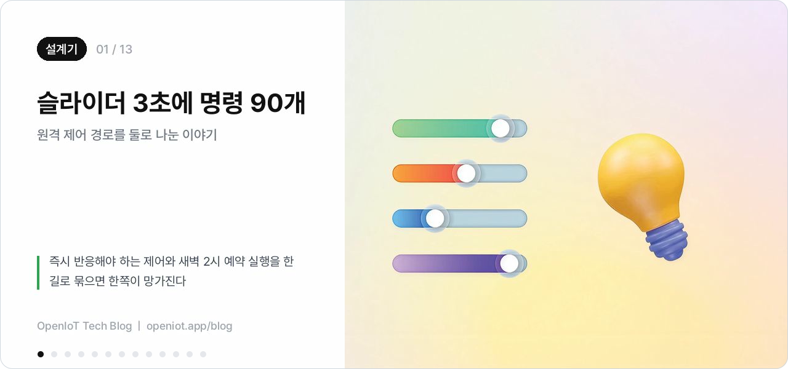
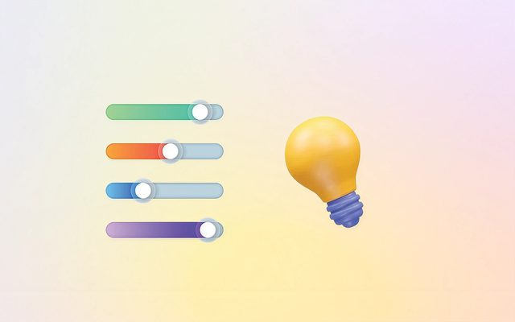
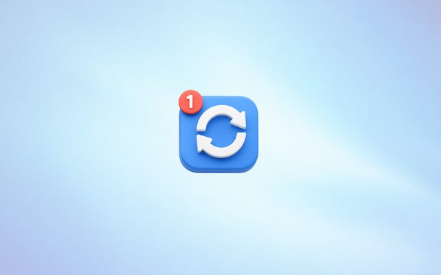
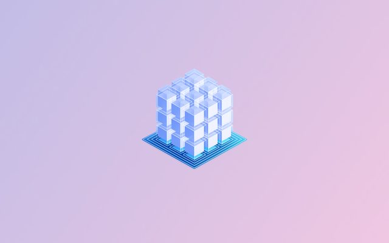
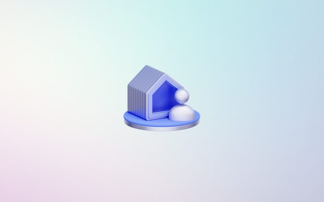
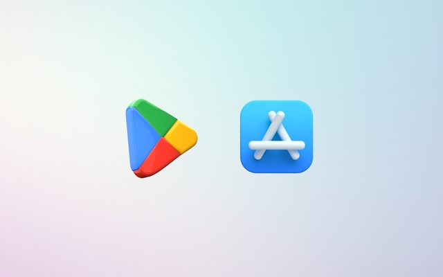
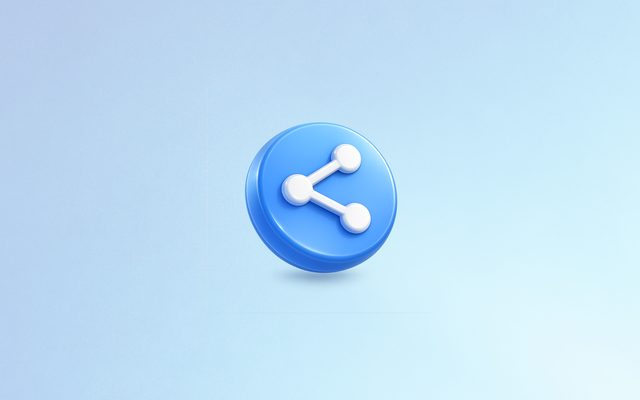
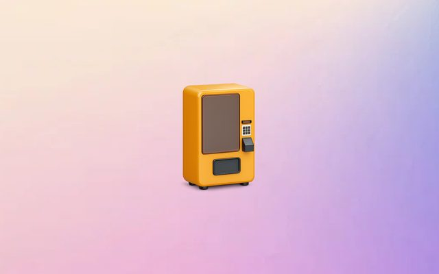
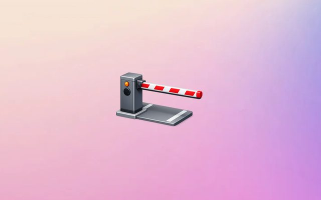
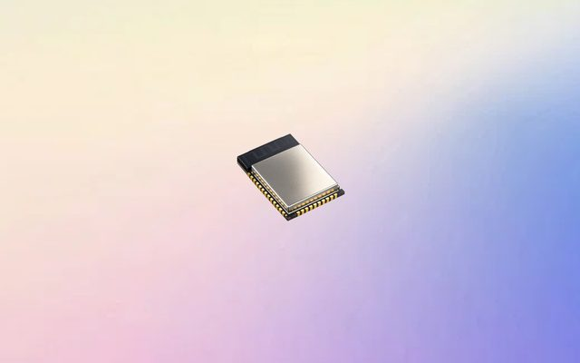

<picture>
  <source media="(prefers-color-scheme: dark)" srcset="./assets/logo-dark.svg">
  
</picture>

### 사람과 사물과 인공지능을 연결해 세상의 문제를 해결합니다

센서의 신호가 앱 화면에 닿기까지, 전 구간을 한 팀이 만듭니다.

---

100곳이 넘는 기업의 IoT 프로젝트를 회로도부터 펌웨어, 앱, 클라우드, AI까지 한 팀 안에서 완성해 왔습니다.
다음 목표는 비전문가도 IoT 제품을 만들고 그 위에 서비스와 AI를 붙이는 데 5분이면 되는 환경입니다.

## 이런 문제를 풉니다

IoT는 화면 하나 뒤에 기기, 통신, 서버가 전부 얽혀 있습니다. 저희가 실제로 부딪힌 문제와 고른 답을 [기술 블로그](https://openiot.app/blog)에 적고 있습니다.

<b>설계기</b> &nbsp;플랫폼을 만들며 고른 구조

 

<table>
<tr>
<td width="33%" valign="top"> <b><a href="https://openiot.app/blog/remote-control-dual-path">슬라이더 3초에 명령 90개</a></b> 원격 제어 경로를 둘로 나눈 이야기</td>
<td width="33%" valign="top"> <b><a href="https://openiot.app/blog/ota-firmware-ab-partition">실패해도 기기가 살아있는 업데이트</a></b> 원격 펌웨어 배포 설계기</td>
<td width="33%" valign="top"> <b><a href="https://openiot.app/blog/device-provisioning-identity-ownership">공장에서 나온 기기가 주인을 찾기까지</a></b> 기기 등록 구조 설계기</td>
</tr>
<tr>
<td width="33%" valign="top"> <b><a href="https://openiot.app/blog/device-liveness-online-status">"지금 켜져 있나요?"에 정확히 답하기</a></b> 기기 상태 판정 분투기</td>
<td width="33%" valign="top"> <b><a href="https://openiot.app/blog/iot-data-pipeline-aggregation">기기 1,000대가 쏟아내는 데이터 감당하기</a></b> 저장과 조회 설계기</td>
<td width="33%" valign="top"> <b><a href="https://openiot.app/blog/multi-tenancy-isolation-rbac">고객사 데이터가 섞이지 않게</a></b> 격리를 약속이 아니라 구조로 만들기</td>
</tr>
<tr>
<td width="33%" valign="top"> <b><a href="https://openiot.app/blog/hybrid-app-shell-one-app">제품이 늘어도 앱은 한 벌</a></b> 하이브리드 앱 셸 설계기</td>
<td width="33%" valign="top"> <b><a href="https://openiot.app/blog/multi-user-device-control-pool">가족 셋이 같은 조명을 켜는 일</a></b> 여러 사람이 여러 기기를 함께 쓰는 구조</td>
<td width="33%" valign="top"> <b><a href="https://openiot.app/blog/iot-security-certification-builtin">보안 인증을 제품에 내장하기</a></b> 고객사의 인증 부담을 대신 지는 설계</td>
</tr>
</table>

<b>현장 구축기</b> &nbsp;고객 현장의 제약에서 시작한 프로젝트

 

<table>
<tr>
<td width="25%" valign="top"> <b><a href="https://openiot.app/blog/vending-machine-retrofit-module">자판기를 뜯지 않는다는 조건에서</a></b> 통합 제어 모듈 개발기</td>
<td width="25%" valign="top"> <b><a href="https://openiot.app/blog/unmanned-parking-direct-control">차단기 앞에서 기다리게 하지 않으려고</a></b> 온라인과 오프라인을 함께 설계한 무인주차 앱</td>
<td width="25%" valign="top"> <b><a href="https://openiot.app/blog/break-time-badge-tagging">사원증 한 장을 두 시스템이 읽습니다</a></b> 자율 휴게 관리 구축기</td>
<td width="25%" valign="top"> <b><a href="https://openiot.app/blog/kisa-iot-security-certification-lite">보안인증은 부품을 고르는 날 시작됩니다</a></b> KISA 라이트 등급 사전 대응기</td>
</tr>
</table>

## 하는 일

| 영역 | 내용 |
|---|---|
| **하드웨어** | 센서 선정, 회로도와 PCB 설계, 프로토타입 제작 |
| **펌웨어** | ESP32, STM32, Nordic 칩별 펌웨어, BLE / Wi-Fi 프로비저닝, 실패해도 이전 버전으로 돌아가는 OTA |
| **통신** | BLE, Wi-Fi, LTE-M / NB-IoT, Matter, Zigbee, RFID / NFC, MQTT |
| **앱** | 제품이 늘어도 한 벌로 유지되는 iOS / Android 앱, 관리자 대시보드 |
| **클라우드** | 쓰지 않을 땐 비용이 0인 서버리스 인프라, 멀티테넌트 격리, 시계열 데이터 집계 |
| **AI** | STT, TTS, 카메라 객체 인식, LLM 기반 이상 감지와 요약 |

## 기술 스택

**Firmware / Hardware** 

**Connectivity** 

**App / Web** 

**Cloud / Backend** 

## 일하는 방식

> **사람과 사물과 인공지능을 연결한다. 엄청 많이!**

방향은 이 한 줄입니다. 그래서 할 일도 둘입니다. 더 많은 연결을 만들어 낼 기술을 만들고, 그 연결을 가로막는 프로세스를 고칩니다.

### 자유와 책임

창의적이고 똑똑한 사람일수록 자유롭게 일하기를 원하고, 그 자유에 책임질 수 있다고 믿습니다.
그래서 출퇴근 시간은 각자 정하고, 크리티컬하지 않은 일은 허락을 기다리지 않고 먼저 처리한 뒤 공유합니다. 완성된 기획서를 받아 구현만 하지 않고, 무엇을 왜 만드는지부터 같이 정합니다.

### 프로게이머처럼 일합니다

게임에서 이기려면 자기 역할을 다하고, 어려운 팀원에게 바로 지원을 가고, 흐름을 읽어 다음 수를 먼저 부릅니다.
저희가 바라는 플레이어도 같습니다. 자기 역할을 압도적으로 해내고, 넓은 시야로 동료에게 어시스트하고, 새 인사이트로 다음 방향을 제안합니다. 잘하는 플레이어에게는 더 좋은 보상이 돌아갑니다.

### 세 가지 수준

모든 행동 기준은 세 수준으로 나뉩니다.

| 수준 | |
|---|---|
| 당연한 수준 | 자기 몫을 해낸다 |
| 훌륭한 수준 | 자기 몫을 넘어 움직인다. 주변을 보고, 먼저 가고, 남의 일도 좋아지게 만든다 |
| **압도적인 수준** | **판을 바꾼다. 이 사람이 지나간 자리는 다음 사람에게 더 쉬워져 있다** |

18개 기준 가운데 개발과 맞닿은 것들의 압도적인 수준은 이렇습니다.

| 기준 | 압도적인 수준 |
|---|---|
| 바퀴를 재발명하지 않는다 | 팀 공통 라이브러리, 디자인 시스템, 템플릿으로 새 프로젝트의 출발선 자체를 앞당긴다 |
| 자동화하고 개선한다 | 개인이 아니라 팀 전체의 반복 업무를 자동화해 팀의 처리량을 끌어올린다 |
| 서로의 안전망이 되어준다 | 사람이 매번 챙기지 않아도 되도록 검증을 시스템에 넣는다 (타입, 스키마, 린트, 테스트, 알림) |
| 빠르고 정확하게 결과물을 만든다 | 결함이 배포 전에 걸러지는 구조(테스트, 리뷰, CI)를 만들어 팀의 품질 하한선을 올린다 |
| 기다리지 않게, 놀라지 않게 한다 | 보고하지 않아도 진행 상황이 자동으로 드러나는 구조를 만든다 |
| 전문성을 가지고 학습한다 | 밝혀낸 암묵지를 문서, 발표, 오픈소스로 공유해 업계의 기준을 끌어올린다 |

실제로는 이렇게 합니다. 규약은 왜 그렇게 정했는지 결정 기록으로 남기고 브랜치 보호와 자동 검사로 막아 둡니다. 사내 규약을 AI 코딩 도구에 심어 리뷰에 쓰고, 회로도와 PCB 배선, 전기 검사까지 파이프라인으로 뽑습니다. 위의 설계기들도 같은 이유로 공개하고 있습니다.

18개 기준 전체와 근무 제도는 **[오픈아이오티 컬쳐덱](https://drive.google.com/file/d/1cYIjkMDLOoMDjJZvqb9dzOfI0y7EmCCe/view)** 에 있습니다.

## 함께할 동료를 찾습니다

실력 있는 사람, 개척하는 사람, 개선하는 사람, 직무 이름에 자신을 가두지 않고 경계를 허무는 사람을 찾습니다.
AI로 이전과 비교할 수 없는 품질과 속도에 도전합니다.

**[지금 열려 있는 포지션 보기](https://openiot.app/careers)** &nbsp;|&nbsp; [채용 절차](https://openiot.app/careers/process) &nbsp;|&nbsp; [혜택과 복지](https://openiot.app/careers/culture)

찾는 포지션이 없다면 [인재풀](https://openiot.app/careers/talent-pool)에 등록해 두세요. 새 포지션이 열리면 가장 먼저 연락드립니다.

## 자체 솔루션

| | |
|---|---|
| [**오토플레이스**](https://openiot.app/solutions/autoplace) | 무인매장 점주를 위한 공간 자동화 서비스 |
| [**오픈플러그**](https://openiot.app/solutions/openplug) | 결제형 IoT 플러그 세팅과 관리 |
| [**방온도**](https://openiot.app/solutions/bangondo) | 제어형 스마트 온도 관리 시스템 |
| [**오픈노트**](https://openiot.app/solutions/opennote) | 스마트 자동 기록 시스템 |

---

**IoT 도입을 고민 중이라면** [도입 문의하기](https://openiot.app/contact) &nbsp;|&nbsp; **함께 만들 사람을 찾습니다** [채용](https://openiot.app/careers)

주식회사 오픈아이오티 &nbsp;|&nbsp; 서울특별시 구로구 디지털로34길 55, 코오롱싸이언스밸리2차

